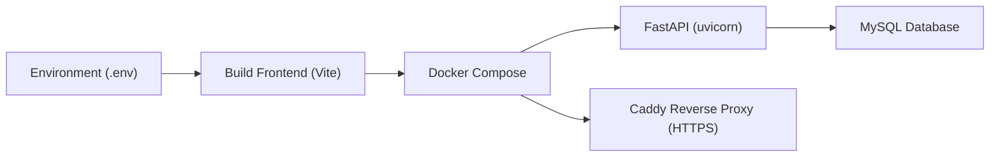
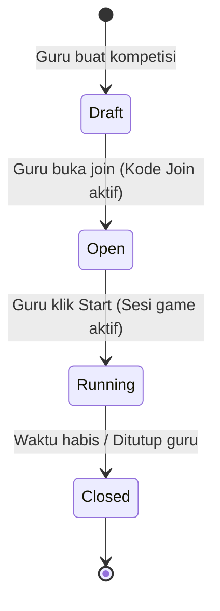

# TTS Arena — Dokumentasi Teknis, Audit Keamanan & Kesiapan Deployment

Dokumen ini disusun sebagai acuan teknis komprehensif, evaluasi keamanan, status perbaikan fitur shareable level (playtest), dan panduan kesiapan deployment sistem bagi pengembang dan agen AI.

---

## 1. Status & Penyelesaian Bug "Shareable Level / Playtest"

### 1.1 Root Cause Analisis Error (Sesuai Foto)
Pada foto tangkapan layar, terjadi error:
```text
(pymysql.err.OperationalError) (1054, "Unknown column 'puzzle_set_id' in 'field list'")
[SQL: INSERT INTO game_sessions (competition_id, group_id, puzzle_set_id, player_name, playtest_token_hash, playtest_csrf_token_hash, status, started_at, ...) VALUES (...)]
```
* **Penyebab**: File migrasi skema `backend/migrations/versions/a1b2c3d4e5f6_add_playtest_support.py` telah dibuat di repositori, namun migrasi Alembic belum dieksekusi terhadap database MySQL yang sedang berjalan (revisi database sebelumnya masih tertinggal di `896d92c79979`).
* **Akibat**: Kolom `puzzle_set_id`, `player_name`, `playtest_token_hash`, `playtest_csrf_token_hash` pada tabel `game_sessions`, serta tabel `playtest_links` belum ada di skema MySQL fisik.

### 1.2 Tindakan Perbaikan yang Telah Dilakukan
1. **Eksekusi Migrasi Database**:
   Menjalankan perintah Alembic ke database MySQL aktif:
   ```bash
   alembic upgrade head
   ```
   Status: Berhasil (`896d92c79979 -> a1b2c3d4e5f6, add playtest support`). Tabel `playtest_links` dan kolom `puzzle_set_id` kini aktif di database MySQL.
2. **Perbaikan Backend Event & Skor (`playtest.py` & `play.py`)**:
   * Memperbaiki bug kritis di endpoint `/api/playtest/events` dan `/api/play/events` di mana dependency session belum terinjeksi dan kalkulasi skor memanggil sesi yang tidak terdefinisi (`NameError`).
   * Skor kini dihitung secara atomik menggunakan sesi tulis aktif (`write_s`) setelah event dan ledger disimpan.
3. **Penyelesaian Masalah Grid Tereset Saat Polling (`ttsReducer.ts` & `PlayPage.tsx`)**:
   * Sebelumnya, polling background setiap 5 detik selalu memanggil `INIT_STATE`, yang menghapus huruf-huruf yang sedang diketik di kisi dan mereset kursor ke (0, 0).
   * Ditambahkan aksi `SYNC_STATE` yang hanya menyinkronkan sel yang terkunci dan status skor tanpa menghapus huruf yang sedang diketik pemain dan tanpa memindahkan posisi kursor.
   * Ditambahkan tombol **"Periksa Kata"** manual di samping tombol otomatis.
4. **Perbaikan Interaksi UI Guru (`TeacherPuzzlesPage.tsx`)**:
   * Menambahkan tombol **"Buat Kode Baru"** di dalam modal share guru, yang memanggil endpoint `POST /api/teacher/playtest/{puzzle_id}/share`.
   * Memperbaiki aksi tombol **"Playtest"** guru agar langsung mengarahkan halaman ke `/playtest/play` setelah inisialisasi sesi berhasil.
   * Tombol salin kode share diperbarui sehingga menyalin tautan lengkap menggunakan `TTS_APP_URL` dengan fallback clipboard yang andal.
5. **Penyempurnaan Alur Pemain (`PlaytestJoinPage.tsx`)**:
   * Menambahkan penanganan `useSearchParams` (`?code=...`) agar peserta yang membuka tautan undangan shareable langsung terisi kode playtest secara otomatis.

---

## 2. Pengecekan Keamanan Aplikasi (Security Assessment)

### 2.1 Ringkasan Evaluasi Keamanan

| Vektor Keamanan | Status | Implementasi & Analisis |
| :--- | :---: | :--- |
| **Autentikasi Guru** | **KUAT** | Password di-hash menggunakan Argon2id (`argon2-cffi`) di thread pool non-blocking. Registrasi dilindungi `TTS_INVITE_CODE` dan rate limiter berbasis IP. |
| **Session Management** | **KUAT** | Cookie `HttpOnly`, `SameSite=Lax`, flag `Secure` dinamis via konfigurasi. Token mentah tidak disimpan di DB; hanya hash SHA-256 yang disimpan. |
| **CSRF Protection** | **KUAT** | Double-submit CSRF cookie + header `x-csrf-token` pada seluruh endpoint mutasi (POST, PATCH, DELETE), disertai validasi `Origin` terhadap `TTS_APP_ORIGIN`. |
| **SQL Injection** | **AMAN** | Seluruh query database menggunakan SQLAlchemy 2.0 ORM / Core dengan parameterized statements. |
| **Formula Injection (CSV)** | **AMAN** | Fitur ekspor CSV di `backend/app/api/teacher.py` telah memproteksi karakter `=`, `+`, `-`, `@` dengan prefix tanda kutip tunggal (`'`). |
| **Multi-Tenancy Isolation** | **KUAT** | Resource guru (puzzles, groups, competitions, audit logs) selalu di-filter berdasarkan `teacher_id` sesi aktif. Akses lintas guru menghasilkan `404 Not Found`. |
| **Information Disclosure** | **DIPERKETAT** | Stack trace dan error database mentah disembunyikan jika `APP_DEBUG=false`. Endpoint `/api/health` telah diperbaiki agar tidak membocorkan exception string database ke publik saat mode debug mati. |

### 2.2 Rekomendasi Hardening Tambahan
1. **Rate Limiting di Multi-Instance**:
   Rate limiter saat ini (`backend/app/core/rate_limit.py`) berjalan in-memory (per proses worker). Jika dideploy dengan beberapa worker atau instance di balik load balancer, gunakan backend Redis atau caching layer terpusat.
2. **CSP (Content Security Policy)**:
   Tambahkan header keamanan HTTP pada Caddyfile (`X-Frame-Options: DENY`, `X-Content-Type-Options: nosniff`, `Content-Security-Policy`).

---

## 3. Kelayakan Software untuk Deployment (Production Readiness)

### 3.1 Checklist Kesiapan Deployment



| Komponen | Status | Catatan / Tindakan Wajib |
| :--- | :---: | :--- |
| **Container Engine** | **Siap** | Menggunakan Docker Compose (FastAPI Uvicorn + Caddy 2 Alpine). |
| **Database Migrasi Otomatis** | **Siap** | `Dockerfile` backend menjalankan `alembic upgrade head` sebelum `uvicorn` aktif. |
| **Database Backup Script** | **Telah Diperbaiki** | File `deploy/backup.sh` sebelumnya masih memakai perintah SQLite (`sqlite3 .backup`). **Telah diperbaiki** menggunakan `mysqldump` terkompresi gzip dengan retensi rotasi 14 hari. |
| **Frontend Static Asset** | **Perhatian** | Caddy me-mount `./frontend/dist:/srv:ro`. Sebelum container dijalankan, perintah build frontend (`npm run build`) harus dijalankan terlebih dahulu pada CI/CD atau host. |
| **TLS / SSL Otomatis** | **Siap** | Caddy mengelola sertifikat TLS Let's Encrypt secara otomatis berdasarkan variabel `DOMAIN`. |

### 3.2 Panduan Konfigurasi Produksi (`.env.example` Reference)
Pastikan nilai variabel berikut disesuaikan saat masuk tahap produksi:
```ini
# Database MySQL Produksi
TTS_DB_USER=tts_prod_user
TTS_DB_NAME=ttsdulu
TTS_DB_PASSWORD=<PASSWORD_KUAT_DAN_UNIK>
TTS_DB_HOST=<HOST_DB_ATAU_DOCKER_NETWORK>
TTS_DB_PORT=3306

# Keamanan Domain & Cookie
DOMAIN=tts.domainsekolah.sch.id
TTS_APP_ORIGIN=https://tts.domainsekolah.sch.id
TTS_APP_URL=https://tts.domainsekolah.sch.id
TTS_COOKIE_SECURE=true
APP_DEBUG=false
TTS_INVITE_CODE=<KODE_UNDANGAN_RAHASIA_GURU>
```

---

## 4. Dokumentasi Teknis Aplikasi (Untuk Komunikasi Agen AI)

### 4.1 Identitas & Arsitektur Sistem
* **Domain**: Platform kompetisi dan latihan Crossword (Teka-Teki Silang) Bahasa Inggris berbasis sekolah.
* **Backend**: Python 3.12, FastAPI, SQLAlchemy 2 (Async `aiomysql` untuk aplikasi runtime, Sync `pymysql` untuk migrasi Alembic), Argon2id.
* **Frontend**: React 19, TypeScript, Vite, Tailwind CSS, React Router v7, Zustand, Lucide Icons.
* **Reverse Proxy & TLS**: Caddy 2 Alpine dengan HTTP/2 dan TLS otomatis.
* **Desain Anti-Cheat**: *Server-Authoritative*. Jawaban puzzle **tidak pernah dikirim ke client peserta/pemain**. Verifikasi kata, hint, dan kalkulasi skor dilakukan sepenuhnya di server.

### 4.2 State Machine Kompetisi & Sesi



### 4.3 Ringkasan API Endpoint

#### A. Publik & Autentikasi
* `GET /api/health`: Status API dan koneksi database.
* `GET /api/time`: Jam server sinkronisasi (ISO & milidetik).
* `POST /api/auth/register`: Pendaftaran guru dengan kode undangan (`invite_code`).
* `POST /api/auth/login`: Login guru, set cookie `tts_teacher` & `tts_teacher_csrf`.
* `POST /api/auth/logout`: Revoke token dan bersihkan cookie.
* `GET /api/auth/me`: Data profil guru aktif.

#### B. Portal Guru (`/api/teacher/...`)
* `GET/POST /api/teacher/puzzles`: Kelola bank puzzle (upload JSON, validasi struktur).
* `GET /api/teacher/puzzles/{id}`: Detail lengkap puzzle beserta preview dan kunci jawaban.
* `POST /api/teacher/puzzles/{id}/publish`: Publikasikan puzzle (bersifat *immutable*).
* `POST/PATCH /api/teacher/groups`: Manajemen kelompok siswa dan reset PIN kelompok.
* `POST /api/teacher/competitions`: Buat kompetisi, atur durasi, kelompok, dan puzzle.
* `POST /api/teacher/competitions/{id}/open`: Buka ruang tunggu kompetisi.
* `POST /api/teacher/competitions/{id}/start`: Mulai serentak seluruh kelompok yang bergabung.
* `POST /api/teacher/competitions/{id}/extend`: Perpanjang durasi waktu.
* `POST /api/teacher/competitions/{id}/close`: Selesaikan kompetisi.
* `GET /api/teacher/competitions/{id}/export.csv`: Unduh rekap nilai terlindungi dari formula injection.
* `POST /api/teacher/playtest/{puzzle_id}/start`: Memulai sesi uji coba puzzle pribadi guru.
* `POST /api/teacher/playtest/{puzzle_id}/share`: Menghasilkan kode shareable level untuk publik.
* `GET /api/teacher/playtest/links`: Daftar link shareable aktif.
* `DELETE /api/teacher/playtest/links/{id}`: Menghapus / mencabut link shareable.

#### C. Mode Kompetisi Siswa (`/api/...`)
* `POST /api/join`: Gabung kompetisi menggunakan `competition_code`, `group_code`, dan `pin`.
* `GET /api/play/state`: Ambil matriks grid bermasker (hanya huruf terbuka/selesai), clue, skor, dan sisa waktu.
* `POST /api/play/events`: Pengiriman batch event idempoten (`word_submit`, `hint_letter`, `hint_word`).
* `GET /api/play/result`: Mengambil rekap hasil akhir permainan kelompok.

#### D. Mode Playtest / Shareable Level (`/api/playtest/...`)
* `POST /api/playtest/{share_code}/join`: Bergabung ke puzzle tanpa kode kelompok dan PIN.
* `GET /api/playtest/state`: State sesi playtest bermasker.
* `POST /api/playtest/events`: Pengiriman jawaban dan hint playtest.
* `GET /api/playtest/result`: Rekap skor dan durasi uji coba.

### 4.4 Aturan Perhitungan Skor & Hint (Server Logic)
* **Word Submit**: Jawaban benar memberikan **+10 poin**. Jawaban salah tidak mengurangi poin (hanya menambah counter percobaan).
* **Hint Letter**: Mengurangi **-3 poin** per huruf yang diminta (maksimal 2 hint per kata).
* **Hint Word**: Mengurangi **-10 poin** (kata ditandai `assisted` dengan skor base 0).
* **Completion**: Menyelesaikan seluruh kisi memberikan bonus **+20 poin**.
* **Total Skor**: Dihitung dari `max(0, SUM(delta))` pada tabel `score_ledger`.

